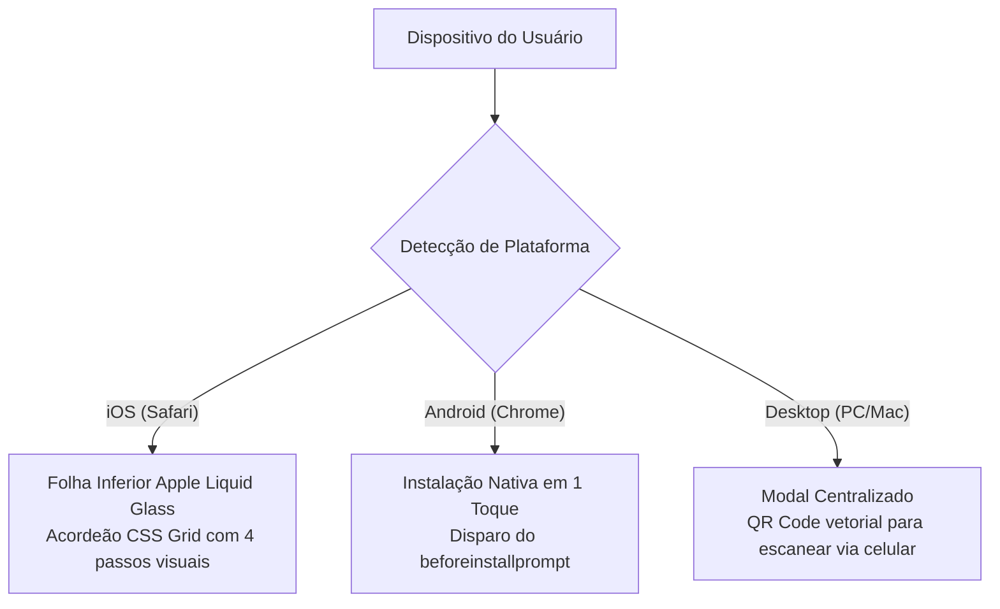
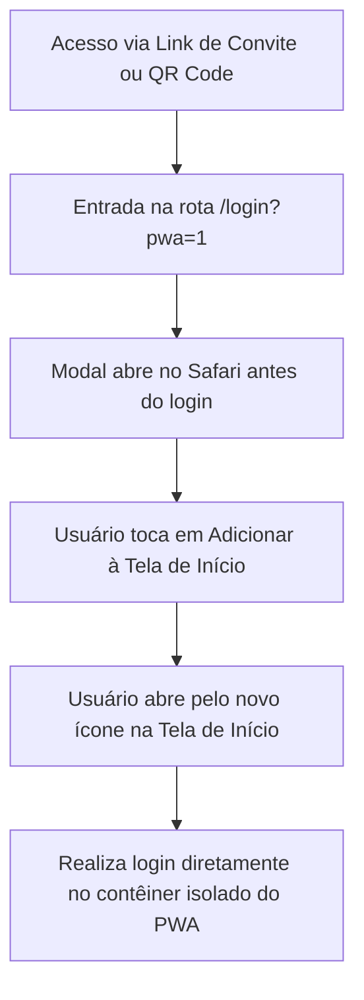

# PWA Modal Installer

> **Apple Liquid Glass PWA Install Modal for React & Next.js.**
> Componente de instalação de Progressive Web App com design nativo da Apple, efeito de vidro translúcido Liquid Glass, animação fluida em acordeão via CSS Grid, ícones oficiais do iOS Safari, captura nativa de `beforeinstallprompt` no Android e QR Code vetorial autocontido no Desktop.

[](LICENSE)
[](https://nextjs.org/)
[](https://react.dev/)
[](https://tailwindcss.com/)
[-emerald.svg)](#instalação-rápida-drop-in)
[](#palavras-chave-e-descoberta-seo)

---

## Sumário

- [Demonstração Visual](#demonstração-visual)
- [Tabela Comparativa (Benchmark)](#tabela-comparativa-benchmark)
- [A Psicologia do PWA: Confiança em vez de Intrusão](#a-psicologia-do-pwa-confiança-em-vez-de-intrusão)
- [O Problema Real do PWA no iOS e Android](#o-problema-real-do-pwa-no-ios-e-android)
- [Arquitetura de Transição em Acordeão](#arquitetura-de-transição-em-acordeão)
- [Instalação Rápida (Drop-in, Zero Dependências)](#instalação-rápida-drop-in-zero-dependências)
- [Exemplo de Uso no Next.js App Router](#exemplo-de-uso-no-nextjs-app-router)
- [Propriedades do Componente (Props)](#propriedades-do-componente-props)
- [Customização de Logo e Cores](#customização-de-logo-e-cores)
- [Solução para Isolamento de Sessão no iOS (Cookies e Login)](#solução-para-isolamento-de-sessão-no-ios-cookies-e-login)
- [Perguntas Frequentes (FAQ)](#perguntas-frequentes-faq)
- [Palavras-chave e Descoberta (SEO e Busca Semântica por IA)](#palavras-chave-e-descoberta-seo-e-busca-semântica-por-ia)
- [Licença](#licença)

---

## Demonstração Visual

### Mobile (Apple Safari iOS e Google Chrome Android)

| iPhone iOS (Inicial Centralizado) | iPhone iOS (Passos Expandidos) | Android (Instalação em 1 Toque) |
| :---: | :---: | :---: |
|  |  |  |

<br />

### Desktop (PC / Mac) e Playground de Demonstração

| Modal Desktop (QR Code Vetorial com LAN IP) | Playground Interativo (Apple Clean White) |
| :---: | :---: |
|  |  |

---

## Tabela Comparativa (Benchmark)

| Critério / Funcionalidade | PWA Modal Installer | Banners Web Genéricos | `@khmyznikov/pwa-install` |
|---|---|---|---|
| **Design Language** | Apple Liquid Glass nativo (vidro translúcido escuro) | Retângulo flat colorido ou Material | Diálogo neutro sem identidade de sistema |
| **Taxa de Conversão (A2HS)** | **Alta:** parece um diálogo de sistema oficial da Apple | **Baixa:** usuário descarta achando que é anúncio | **Média:** aspecto de biblioteca genérica |
| **Dependências Externas** | **Zero (0 dependências):** ícones SVG nativos autocontidos | Exige bibliotecas de terceiros | Requer Web Components externos |
| **Animação no iOS Safari** | Acordeão suave em CSS Grid (`0fr` -> `1fr`) sem layout shift | Salto visual brusco ou texto estático | Modal estático rígido |
| **Ícones do iOS** | Vetores idênticos aos do Safari (Share, 3 dots, Add) | Ícones genéricos ou emojis descontextualizados | Ícones genéricos monocromáticos |
| **Suporte Desktop** | QR Code SVG vetorial ultraleve (15 KB) com IP local | Apenas esconde o banner | Texto genérico sem QR Code nativo |
| **Teste Local (Wi-Fi)** | Detecção e exibição automática do LAN IP para o celular | Somente localhost | Somente localhost |
| **Next.js & React 19** | Total compatibilidade com App Router e Server/Client Components | Erros comuns de hidratação SSR | Exige wrappers complexos de Web Component |

---

## A Psicologia do PWA: Confiança em vez de Intrusão

A maioria das soluções de instalação de PWA na web falham pelo mesmo motivo: parecem anúncios pop-up agressivos. O usuário moderno tem reflexo condicionado de clicar no "X" ou ignorar qualquer barra colorida que suba na tela.

O **PWA Modal Installer** aborda o problema sob a ótica da **confiança do usuário**:

1. **Estética do Próprio Sistema Operacional:** O modal utiliza o efeito translúcido escuro `bg-[#1e202e]/85` com `backdrop-blur-[32px]`, contorno em specular highlight superior e sombra suave de elevação. Para o usuário de iPhone, o diálogo passa a impressão de ser uma recomendação nativa do iOS.
2. **Botões com Simetria e Respiro:** O botão de ação ("Adicionar à Tela de Início") e o botão de navegação ("Voltar") compartilham alinhamento centralizado, tipografia sutil de 15px e superfície de vidro fosco, sem cores primárias artificiais que lembrem banners comerciais.
3. **Não Bloqueia o Conteúdo:** No mobile, o modal se apoia como uma folha inferior (`bottom sheet`), permitindo ao usuário continuar visualizando o site ao fundo enquanto decide prosseguir.

---

## O Problema Real do PWA no iOS e Android



1. **A Barreira do iOS:** A Apple não disponibiliza o evento `beforeinstallprompt` no Safari. A única rota para transformar o site em aplicativo é o usuário tocar manualmente em "Compartilhar" e rolar até "Adicionar à Tela de Início". Sem orientação visual idêntica aos ícones reais do Safari, mais de 80% das tentativas de instalação no iPhone são abandonadas.
2. **O Desafio do Android:** O Chrome oferece suporte ao evento nativo, mas se a página não capturar o evento antecipadamente ou exibir uma interface desajeitada, a taxa de rejeição cresce significativamente.
3. **A Lacuna do Desktop:** Usuários no computador que gostariam de utilizar o aplicativo no celular costumam se deparar com avisos estáticos. O QR Code vetorial imediato permite apontar a câmera do celular e instalar em segundos.

---

## Arquitetura de Transição em Acordeão

Para eliminar travamentos e evitar o cálculo forçado de geometria no JavaScript (que causa quedas de FPS no Safari mobile), a transição entre o estado inicial e o passo a passo utiliza CSS Grid puro:

```tsx
<div
  className="grid transition-[grid-template-rows] duration-400 ease-[cubic-bezier(0.32,0.72,0,1)]"
  style={{ gridTemplateRows: isAccordionOpen ? "1fr" : "0fr" }}
>
  <div className="overflow-hidden">
    {/* Lista com os 4 passos em vidro fosco */}
  </div>
</div>
```

A curva de aceleração cúbica `cubic-bezier(0.32, 0.72, 0, 1)` replica a inércia física do Spring Animation da Apple, oferecendo sensação de continuidade ao abrir e fechar as instruções.

---

## Instalação Rápida (Drop-in, Zero Dependências)

Não é necessário adicionar bibliotecas pesadas ao seu `package.json`. Basta copiar 4 arquivos para o seu projeto:

```bash
# Estrutura de arquivos no seu projeto
src/
├── components/
│   ├── pwa-install-modal.tsx  # Componente principal do modal
│   └── icons.tsx              # Todos os ícones SVG nativos autocontidos
└── lib/
    ├── pwa.ts                 # Detecção de plataforma e regras de exibição
    └── qr.ts                  # Gerador de QR Code vetorial SVG puro (15 KB)
```

> **Zero Dependências:** Todos os vetores gráficos necessários (Compartilhar do Safari, Menu de Três Pontos, Seta de Rolagem, Adicionar à Tela de Início, Download, Fechar e Copiar) estão incluídos como código TypeScript puro em `icons.tsx`.

---

## Exemplo de Uso no Next.js App Router

Adicione o modal diretamente no seu arquivo de layout raiz:

```tsx
// src/app/layout.tsx
import { PwaInstallModal } from "@/components/pwa-install-modal";

export default function RootLayout({
  children,
}: {
  children: React.ReactNode;
}) {
  return (
    <html lang="pt-BR">
      <body>
        {children}

        {/* Modal de Instalação com detecção automática */}
        <PwaInstallModal
          appName="Meu Aplicativo"
          appSubtitle="Aplicativo Oficial"
          appDescription="Este site possui funcionalidade de aplicativo. Adicione à Tela de Início para uma melhor experiência e fácil acesso."
        />
      </body>
    </html>
  );
}
```

---

## Propriedades do Componente (Props)

| Propriedade | Tipo | Padrão | Descrição |
|---|---|---|---|
| `appName` | `string` | `"Meu Aplicativo"` | Título principal exibido no topo do modal |
| `appSubtitle` | `string` | `"Aplicativo Oficial"` | Subtítulo ou categoria ao lado do título |
| `appDescription` | `string` | Mensagem explicativa padrão | Texto explicativo da vantagem de instalar |
| `appIcon` | `ReactNode` | Ícone de smartphone padrão | Componente visual ou tag `` com o logo da marca |
| `forcePlatform` | `"ios" \| "android" \| "desktop"` | `undefined` | Permite simular qualquer plataforma para depuração |
| `forceOpen` | `boolean` | `undefined` | Controla externamente se o modal deve ficar visível |
| `initialAccordionOpen` | `boolean` | `false` | Inicia o acordeão de passos expandido |
| `onClose` | `() => void` | `undefined` | Função chamada quando o usuário fecha o diálogo |
| `storageKey` | `string` | `"pwa_modal_dismissed"` | Chave no `localStorage` para persistir fechamento |
| `desktopLanIp` | `string` | `"192.168.15.5"` | IP de rede local para testes do QR Code via Wi-Fi |
| `showQrOnDesktop` | `boolean` | `true` | Habilita a exibição do QR Code em computadores |
| `customInstallUrl` | `string` | `undefined` | URL customizada codificada no QR Code |

---

## Customização de Logo e Cores

Para utilizar o logo real da sua aplicação, basta passar um nó React na propriedade `appIcon`:

```tsx
import Image from "next/image";
import { PwaInstallModal } from "@/components/pwa-install-modal";

export function MeuPromptPwa() {
  return (
    <PwaInstallModal
      appName="Bluvalo"
      appSubtitle="Finanças do Casal"
      appIcon={
        <div className="relative h-12 w-12 shrink-0 overflow-hidden rounded-[14px] shadow-md">
          <Image
            src="/icon-192.png"
            alt="Logo Bluvalo"
            width={48}
            height={48}
            className="h-full w-full object-cover"
          />
        </div>
      }
    />
  );
}
```

---

## Solução para Isolamento de Sessão no iOS (Cookies e Login)

No Safari do iOS, existe um comportamento crítico documentado pela Apple: o armazenamento de cookies e sessão do navegador Safari é separado do contêiner isolado da Web App quando adicionada à tela inicial.

Se o usuário realizar login no Safari e apenas depois instalar o PWA, a sessão não é transferida e ele precisará digitar as credenciais novamente.

### Fluxo de Conversão Recomendado:



Ao incluir o parâmetro `?pwa=1` na URL de convites ou campanhas, o componente identifica a intenção e apresenta o modal imediatamente na página de login, assegurando que toda a autenticação ocorra dentro do aplicativo definitivo.

---

## Perguntas Frequentes (FAQ)

### Como testar o modal no iPhone físico durante o desenvolvimento local?
Inicie o Next.js ouvindo todas as interfaces de rede com o comando `next dev -H 0.0.0.0`. Em seguida, informe o seu IP local (exemplo: `192.168.1.100`) na propriedade `desktopLanIp`. No seu computador, abra a página em tela cheia e aponte a câmera do celular para o QR Code gerado pelo componente.

### O modal volta a aparecer para quem já está com o PWA aberto?
Não. O componente executa verificações em runtime contra `window.matchMedia("(display-mode: standalone)").matches` e `navigator.standalone`. Quando a aplicação está em execução no modo aplicativo, o modal não é montado.

### O fechamento do modal fica salvo?
Sim. Ao clicar no botão de fechar, a ação é gravada no `localStorage` sob a chave informada na propriedade `storageKey`, impedindo reexibições invasivas durante a navegação normal.

### Como acionar o modal por um botão na minha própria página?
Basta alternar a propriedade `forceOpen={true}` através do estado da sua página ou despachar o evento nativo:

```tsx
function abrirInstalacao() {
  window.dispatchEvent(new CustomEvent("pwa:open-install"));
}
```

---

## Palavras-chave e Descoberta (SEO e Busca Semântica por IA)

Este repositório foi arquitetado para máxima relevância em motores de busca e modelos de inteligência artificial (ChatGPT, Claude, Perplexity, Gemini, Copilot e GitHub Search):

- **High-Intent Search Terms:**
  - `react pwa install modal apple style`
  - `ios safari add to home screen component nextjs`
  - `pwa liquid glass prompt component`
  - `beforeinstallprompt chrome android react hook`
  - `apple action sheet pwa install tutorial`
  - `standalone pwa display mode detection nextjs app router`
  - `how to solve pwa cookie session isolation ios safari`
  - `zero dependency pwa qr code modal react`
- **Tópicos GitHub:** `pwa`, `progressive-web-app`, `apple-design`, `liquid-glass`, `safari-ios`, `add-to-home-screen`, `react-pwa-install`, `nextjs-pwa`, `beforeinstallprompt`, `tailwind-pwa`.

---

## Licença

Distribuído sob a licença MIT. Consulte o arquivo [LICENSE](LICENSE) para mais detalhes.
