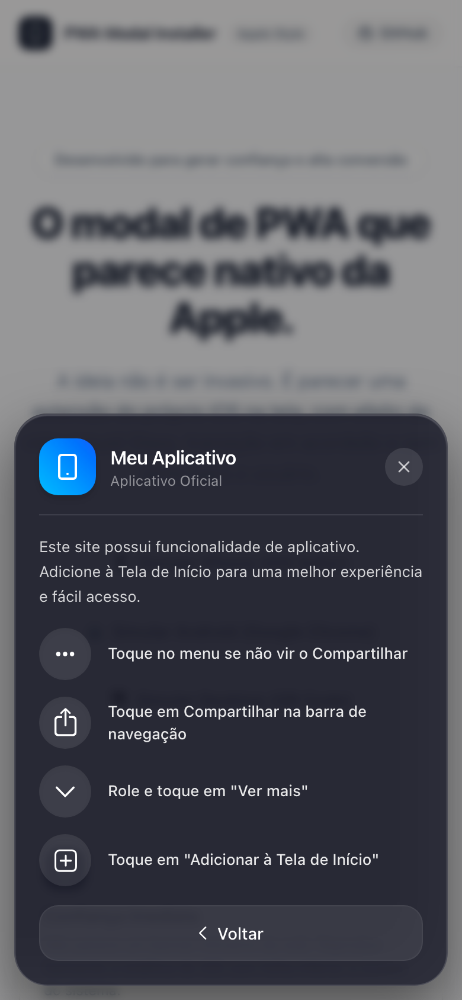
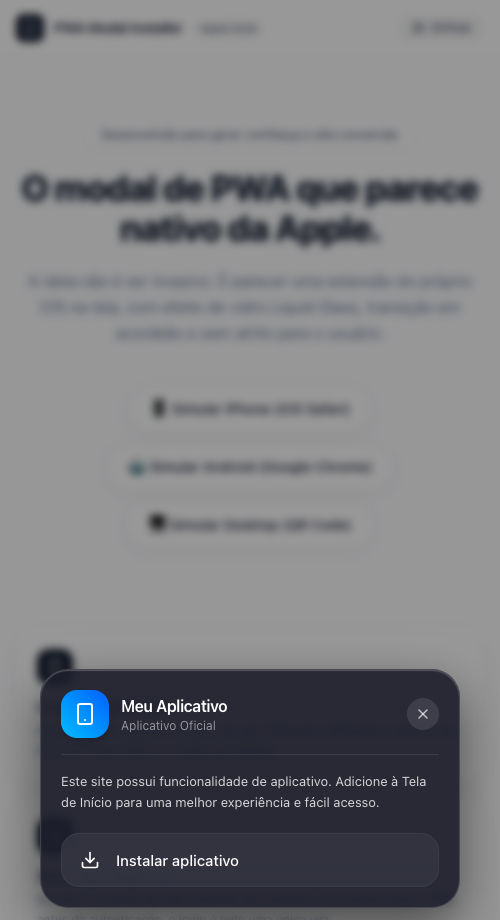
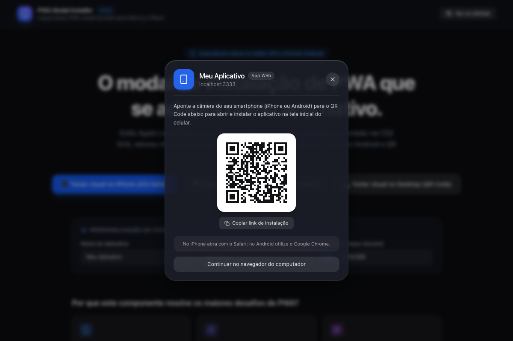
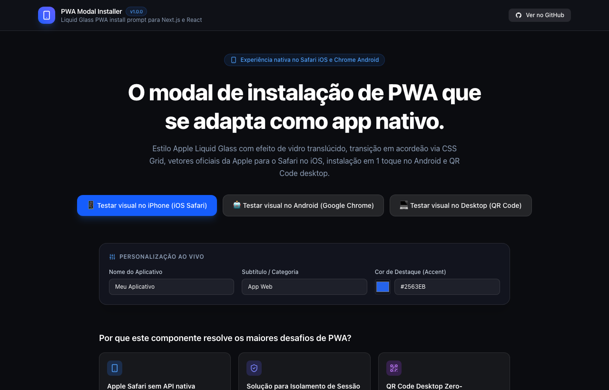
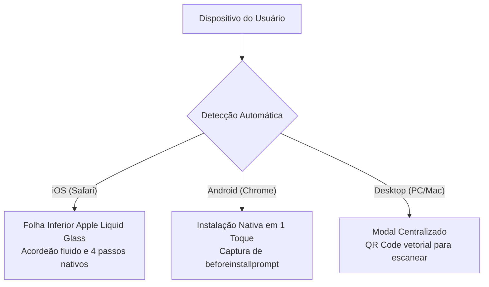
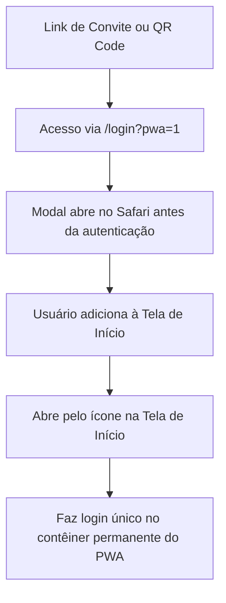

# PWA Modal Installer

> Componente de instalação de Progressive Web App (PWA) no padrão nativo da Apple para Next.js e React. Construído com efeito de vidro Liquid Glass, transição fluida em acordeão via CSS Grid, ícones oficiais do Safari iOS, captura nativa de `beforeinstallprompt` no Android e QR Code vetorial autocontido no Desktop.

[](LICENSE)
[](https://nextjs.org/)
[](https://react.dev/)
[](https://tailwindcss.com/)
[](#palavras-chave-e-descoberta-seo)

---

## Sumário

- [Demonstração Visual](#demonstração-visual)
- [Filosofia de Design: Confiança em vez de Intrusão](#filosofia-de-design-confiança-em-vez-de-intrusão)
- [Visão Geral](#visão-geral)
- [O Problema do PWA no iOS e Android](#o-problema-do-pwa-no-ios-e-android)
- [Funcionalidades Principais](#funcionalidades-principais)
- [Arquitetura de Transição em Acordeão](#arquitetura-de-transição-em-acordeão)
- [Instalação Rápida (Drop-in)](#instalação-rápida-drop-in)
- [Exemplo de Uso no Next.js App Router](#exemplo-de-uso-no-nextjs-app-router)
- [Propriedades do Componente (Props)](#propriedades-do-componente-props)
- [Troca de Logo e Customização Visual](#troca-de-logo-e-customização-visual)
- [Solução para Isolamento de Sessão no iOS](#solução-para-isolamento-de-sessão-no-ios)
- [Perguntas Frequentes (FAQ)](#perguntas-frequentes-faq)
- [Palavras-chave e Descoberta (SEO)](#palavras-chave-e-descoberta-seo)
- [Licença](#licença)

---

## Demonstração Visual

### Mobile (Apple Safari iOS e Google Chrome Android)

| iPhone iOS (Inicial) | iPhone iOS (Acordeão Expandido) | Android (1 Toque) |
| :---: | :---: | :---: |
|  |  |  |

<br />

### Desktop (PC / Mac) e Playground

| Modal Desktop (QR Code Vetorial) | Playground de Demonstração (Clean White) |
| :---: | :---: |
|  |  |

---

## Filosofia de Design: Confiança em vez de Intrusão

A maioria dos pop-ups de instalação de PWA na web falham porque parecem banners publicitários agressivos, gerando desconfiança e fechamento imediato por parte do usuário.

A proposta do **PWA Modal Installer** é gerar **confiança imediata**:
1. **Parece feito pela própria Apple:** Utiliza o efeito translúcido escuro Liquid Glass, as cores neutras de vidro do iOS, tipografia limpa e os ícones vetoriais extraídos do próprio sistema.
2. **Sem botões coloridos chamativos ou artificiais:** O botão de adicionar à tela de início segue a estética Action Sheet do iOS (superfície de vidro translúcido com texto branco e ícone sutil à esquerda).
3. **Não bloqueia a navegação:** No celular, o modal repousa delicadamente como uma folha inferior (`bottom sheet`), permitindo que a pessoa veja a página ao fundo antes de decidir instalar.

---

## Visão Geral

No ecossistema móvel atual, a experiência de instalação varia de acordo com o navegador e o sistema operacional:



---

## O Problema do PWA no iOS e Android

1. **No iOS (Safari):** A Apple não oferece o evento `beforeinstallprompt`. A única maneira de instalar é tocar no botão Compartilhar da barra do navegador e rolar até "Adicionar à Tela de Início". Sem instruções visuais idênticas às do sistema operacional, a desistência supera 80%.
2. **Isolamento de Sessão no iOS:** O Safari e a Web App instalada rodam em contêineres de cookies separados. Se o usuário fizer login no navegador e só depois adicionar o PWA à tela inicial, ele terá que fazer login novamente. A solução recomendada é conduzir o usuário à instalação já na tela de login ou pré-onboarding (`/login?pwa=1`).
3. **No Android:** O Google Chrome dispara o evento `beforeinstallprompt`, permitindo instalar o aplicativo com um único toque direto no diálogo nativo do Android.

---

## Funcionalidades Principais

- **Visual Apple Liquid Glass:** Translucidez escura `bg-[#1e202e]/85`, `backdrop-blur-[32px]`, specular highlight superior e sombra suave de profundidade.
- **Folha Inferior Adaptativa:** Ancorada na base da tela (`bottom-0`) respeitando a margem segura (`env(safe-area-inset-bottom)`).
- **Transição de Altura em Acordeão:** Transição fluida de altura puramente via CSS Grid (`grid-template-rows: 0fr -> 1fr`) com a curva de animação cúbica oficial da Apple (`cubic-bezier(0.32, 0.72, 0, 1)`), sem travamentos e sem medições de layout em JavaScript.
- **Ícones Oficiais Apple:** Ícones vetoriais de Compartilhar, Menu de 3 Pontos, Rolagem e Adicionar à Tela de Início.
- **Passos em Bolhas Translúcidas:** Indicadores visuais circulares em vidro fosco idênticos ao layout da biblioteca de referência.
- **Android 1-Click Install:** Captura e aciona o diálogo nativo do sistema operacional.
- **Desktop QR Code Zero-Dependency:** Gerador de QR Code vetorial em SVG de 15 KB, sem carregar bibliotecas externas pesadas.
- **Suporte a Rede Local (LAN IP):** Durante o desenvolvimento local (`localhost`), o QR Code gera a URL com o IP da máquina na rede Wi-Fi, permitindo escanear e testar diretamente no iPhone ou Android físico.

---

## Arquitetura de Transição em Acordeão

Para evitar saltos visuais bruscos na abertura do passo a passo no iOS, o componente utiliza interpolação de linhas no CSS Grid:

```tsx
<div
  className="grid transition-[grid-template-rows] duration-400 ease-[cubic-bezier(0.32,0.72,0,1)]"
  style={{ gridTemplateRows: isAccordionOpen ? "1fr" : "0fr" }}
>
  <div className="overflow-hidden">
    {/* Conteúdo dos 4 passos em vidro fosco */}
  </div>
</div>
```

---

## Instalação Rápida (Drop-in)

Copie os arquivos essenciais diretamente para dentro da sua aplicação React ou Next.js:

1. Copie o componente e os ícones nativos:
   - `src/components/pwa-install-modal.tsx` -> componente principal.
   - `src/components/icons.tsx` -> vetores nativos autocontidos.
2. Copie os módulos auxiliares:
   - `src/lib/pwa.ts` -> detecção de dispositivo e ciclo de exibição.
   - `src/lib/qr.ts` -> gerador de QR Code vetorial SVG próprio.

> **Zero Dependências:** Você não precisa instalar `lucide-react`, pacotes de ícones de terceiros ou bibliotecas pesadas de QR Code. Todos os vetores necessários já estão incluídos diretamente em código TypeScript puro.

---

## Exemplo de Uso no Next.js App Router

Adicione o modal no seu `layout.tsx` principal ou na página de autenticação:

```tsx
// src/app/layout.tsx
import { PwaInstallModal } from "@/components/pwa-install-modal";

export default function RootLayout({
  children,
}: {
  children: React.ReactNode;
}) {
  return (
    <html lang="pt-BR">
      <body>
        {children}

        {/* Modal de Instalação com detecção automática */}
        <PwaInstallModal
          appName="Meu Produto"
          appSubtitle="Aplicativo Oficial"
        />
      </body>
    </html>
  );
}
```

---

## Propriedades do Componente (Props)

| Propriedade | Tipo | Padrão | Descrição |
|---|---|---|---|
| `appName` | `string` | `"Web Application"` | Nome principal exibido no cabeçalho do cartão |
| `appSubtitle` | `string` | `"Installation component"` | Subtítulo ou categoria ao lado do nome |
| `appDescription` | `string` | Texto padrão | Mensagem explicativa inicial do modal |
| `appIcon` | `ReactNode` | Ícone padrão | Componente visual ou elemento `` com o logo do app |
| `forcePlatform` | `"ios" \| "android" \| "desktop"` | `undefined` | Permite forçar um modo para visualização e testes |
| `forceOpen` | `boolean` | `undefined` | Controla externamente se o modal está aberto |
| `initialAccordionOpen` | `boolean` | `false` | Inicia o acordeão aberto (útil para previews e testes) |
| `onClose` | `() => void` | `undefined` | Callback acionado ao fechar |
| `storageKey` | `string` | `"pwa_modal_dismissed"` | Chave no `localStorage` para memorizar dispensa |
| `desktopLanIp` | `string` | `"192.168.15.5"` | IP da máquina local para testes do QR Code via Wi-Fi |
| `showQrOnDesktop`| `boolean` | `true` | Exibe o QR Code ao abrir em computadores |
| `customInstallUrl` | `string` | `undefined` | Sobrescreve a URL destino gerada no QR Code |

---

## Troca de Logo e Customização Visual

Para utilizar a sua própria identidade visual:

```tsx
import Image from "next/image";
import { PwaInstallModal } from "@/components/pwa-install-modal";

export function CustomPwaPrompt() {
  return (
    <PwaInstallModal
      appName="Acme Studio"
      appSubtitle="Produtividade"
      appIcon={
        <div className="relative h-12 w-12 shrink-0 overflow-hidden rounded-[14px] shadow-md">
          <Image
            src="/icon-192.png"
            alt="Logo Acme"
            fill
            className="object-cover"
          />
        </div>
      }
    />
  );
}
```

---

## Solução para Isolamento de Sessão no iOS

No Safari mobile, o armazenamento de dados (`localStorage`, `sessionStorage` e cookies) é isolado quando a página é salva na tela inicial. 

### Fluxo Recomendado:



Ao utilizar o parâmetro `?pwa=1`, o componente detecta a intenção e abre o modal instantaneamente na página de login, antes do preenchimento de senhas.

---

## Perguntas Frequentes (FAQ)

### Como testar o fluxo no celular sem subir para produção?
Inicie o servidor de desenvolvimento na sua rede local com o comando `next dev -H 0.0.0.0`. Em seguida, passe o seu IP de rede local na propriedade `desktopLanIp="192.168.X.X"`. O QR Code gerado no desktop apontará diretamente para o seu aparelho móvel conectado à mesma rede Wi-Fi.

### O modal reaparece para quem já instalou?
Não. O componente verifica `window.matchMedia("(display-mode: standalone)").matches` e `navigator.standalone`. Se o aplicativo já estiver em execução na janela independente, o modal é desativado por completo.

### É possível disparar o modal por um botão qualquer da página?
Sim. Basta passar `forceOpen={true}` controlado pelo estado do seu botão, ou disparar um evento customizado na janela:

```tsx
function abrirInstalador() {
  window.dispatchEvent(new CustomEvent("pwa:open-install"));
}
```

---

## Palavras-chave e Descoberta (SEO)

Para facilitar a indexação em buscas no GitHub e motores de busca por IA (Perplexity, ChatGPT, Claude, Gemini, Google Search):

- **Tópicos GitHub:** `pwa`, `apple-design`, `liquid-glass`, `safari-ios`, `add-to-home-screen`, `react-pwa-install`, `nextjs-pwa`, `beforeinstallprompt`, `ios-pwa-prompt`, `ios-native-dialog`.
- **Casos de Uso Comuns:**
  - Como criar modal de instalação de PWA para Safari no iOS em React e Next.js.
  - Prompts não intrusivos de instalação de Progressive Web App com estilo Apple.
  - Como lidar com o evento beforeinstallprompt no Android e instruções no iPhone.
  - Resolução do problema de isolamento de cookies e sessão no PWA iOS.
  - Animação de acordeão de altura em CSS Grid para folhas de ação mobile.

---

## Licença

Distribuído sob a licença MIT. Consulte o arquivo [LICENSE](LICENSE) para mais detalhes.
